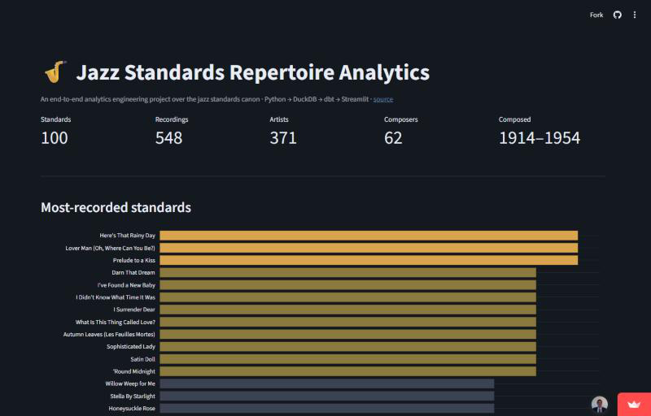
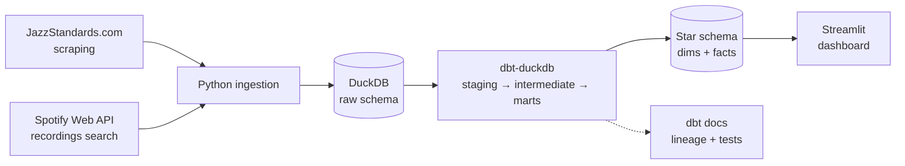

# 🎷 Jazz Standards Repertoire Analytics

> Analyzing the canon of jazz standards through modern data engineering.

**Status: ✅ v1 complete** — built in public, start to finish. See the [roadmap](#roadmap).

**▶️ Live dashboard: [jazz-standards-analytics.streamlit.app](https://jazz-standards-analytics.streamlit.app/)**

An end-to-end analytics engineering project that ingests, models, and visualizes data about jazz standards: which tunes form the canon, who recorded them, and how the repertoire evolved across eras. Built as a real-world application of the modern data stack — and as a way to connect my two daily disciplines: data and jazz guitar.

[](https://jazz-standards-analytics.streamlit.app/)

---

## Architecture



**Stack:** Python · DuckDB · dbt (dbt-duckdb) · Streamlit · Git

| Layer | Tool | Why |
|---|---|---|
| Ingestion | Python (`requests`, `beautifulsoup4`, `spotipy`) | Scraping the standards canon + Spotify recordings metadata |
| Storage | DuckDB | Local, file-based, zero-infra analytical database |
| Transformation | dbt-duckdb | Tested, documented, layered SQL models |
| Serving | Streamlit | Interactive dashboard reading directly from the marts |

## Data model

Data flows through dbt layers — **staging** (clean, 1:1 with sources), **intermediate** (entity resolution + deduplication of recording versions), and **marts**, a dimensional **star schema**:

- `fct_recordings` — grain: one recording of a standard by an artist
- `dim_standards` — title, composer, lyricist, year, popularity rank, decade
- `dim_artists` — name, Spotify id, number of standards recorded
- `dim_years` — year, decade, and a jazz-era label (Swing, Bebop, Hard Bop…)

On top sit three metric models (`rpt_most_recorded_standards`, `rpt_standard_longevity`, `rpt_composer_footprint`). Every model ships with schema tests (`not_null`, `unique`, relationship tests) and column-level docs via `dbt docs` — 11 models, 32 tests, all green.

## Project structure

```
jazz-standards-analytics/
├── ingestion/            # Python: scraping, Spotify API, load to DuckDB raw
├── dbt_project/
│   ├── models/
│   │   ├── staging/      # 1:1 with sources — cleaning, casting, renaming
│   │   ├── intermediate/ # entity resolution + deduplication
│   │   └── marts/        # star schema (dims + facts) + rpt_ metric models
│   └── macros/           # reusable SQL (e.g. normalize_title)
├── dashboard/            # Streamlit app + the exported CSVs it reads
├── data/                 # DuckDB database file (gitignored)
└── docs/                 # per-step explainer PDFs + decisions log
```

## Roadmap

Progress is tracked here as steps are completed — dates mark actual completion.

- [x] **01 · Design** — project scope, architecture and dimensional model · *done 2026-06-10*
- [x] **02.1 · Ingestion — standards** — scrape the JazzStandards.com canon → `raw.standards` · *done 2026-06-24*
- [x] **02.2 · Ingestion — recordings** — Spotify Web API search → `raw.recordings` · *done 2026-06-24*
- [x] **03 · Staging** — dbt staging layer, source definitions, basic tests · *done 2026-07-08*
- [x] **04 · Marts** — intermediate models + star schema with relationship tests · *done 2026-09-20*
- [x] **05 · Docs & metrics** — dbt docs, lineage, most-recorded standards, longevity score · *done 2026-10-02*
- [x] **06 · Dashboard** — Streamlit app [live on Streamlit Community Cloud](https://jazz-standards-analytics.streamlit.app/) · *done 2026-11-24*
- [x] **07 · Write-up** — screenshots, polished README, closing post · *done 2026-11-24*

## Questions this project answers

- Which standards are the most recorded — and does the "canon" match what jam sessions actually call?
- How does a composer's footprint evolve over decades (Ellington vs. Porter vs. Monk)?
- Which artists have the widest repertoire overlap, and who recorded the deep cuts?

## Highlights

From the finished marts (top 100 standards, ~550 deduplicated recordings):

- **Most recorded:** "Here's That Rainy Day", "Lover Man", "Prelude to a Kiss".
- **Longest-lived:** "Ain't Misbehavin'" and "I Got Rhythm" — a ~98-year recording span.
- **Biggest composer footprint:** George Gershwin (11 standards, 55 recordings), then Duke Ellington (6 / 43).
- **Widest repertoire:** Ella Fitzgerald (21 standards), Billie Holiday (14).

> ⚠️ Honest caveats: recordings are capped at 10 per standard (ingestion scope), and Spotify's `release_date` is a release — not recording — date, so reissues skew eras later. Each model documents its assumptions; see the [decisions log](docs/decisions.md).

## Running locally

```bash
# 1. Install dependencies
pip install -r requirements.txt

# 2. Add Spotify API credentials (free app at developer.spotify.com/dashboard)
cp .env.example .env            # then fill in SPOTIFY_CLIENT_ID / SECRET

# 3. Ingest: scrape standards + fetch Spotify recordings → data/jazz.duckdb
python -m ingestion.run_ingestion

# 4. Transform + test with dbt
cd dbt_project && dbt build --profiles-dir . && cd ..

# 5. Run the dashboard
python dashboard/export_marts.py          # refresh the CSVs the app reads
streamlit run dashboard/streamlit_app.py
```

Or just open the [live dashboard](https://jazz-standards-analytics.streamlit.app/).

## Documentation

Each step has a short explainer PDF in [`docs/`](docs/):

- [Project overview](docs/project-overview.pdf) — the initial design doc (day 1)
- [Step 03 · Staging](docs/step-03-staging.pdf) · [Step 04 · Marts](docs/step-04-marts.pdf) · [Step 05 · Docs & metrics](docs/step-05-docs-metrics.pdf) · [Step 06 · Dashboard](docs/step-06-dashboard.pdf)

The build was logged in public on my [blog](https://mbergr.github.io/portfolio/blog/) (logs #1–#6).

## About

I'm [Mathias Berg](https://mbergr.github.io/portfolio/), a Data Analyst in Stuttgart moving into analytics engineering. I also play jazz guitar — this project analyzes the same repertoire I practice.

📫 [LinkedIn](https://www.linkedin.com/in/mbergr/) · [Blog](https://mbergr.github.io/portfolio/blog/) · mathias.berg.1992@gmail.com
